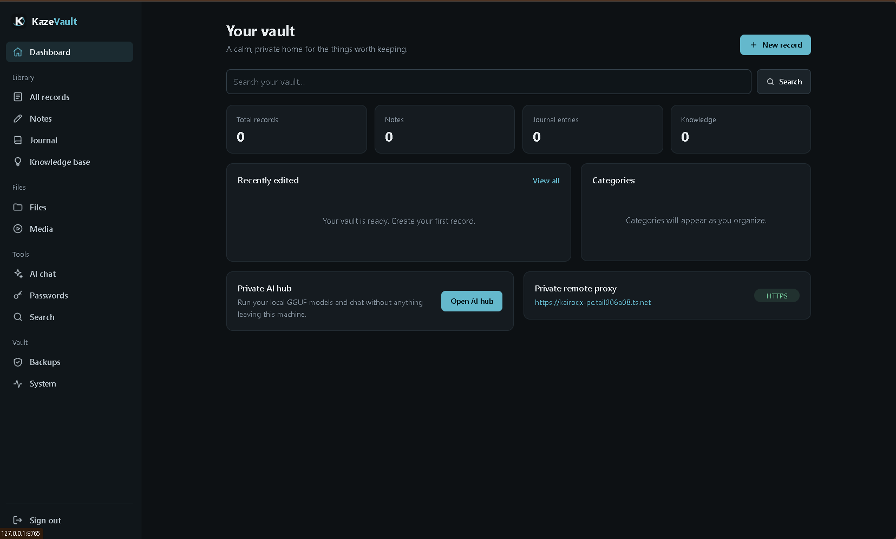
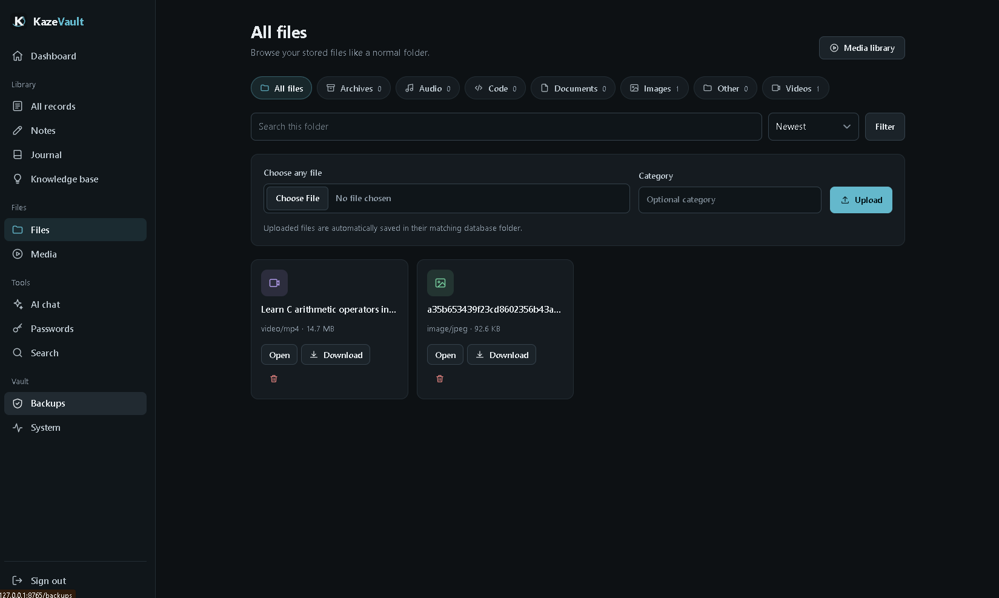
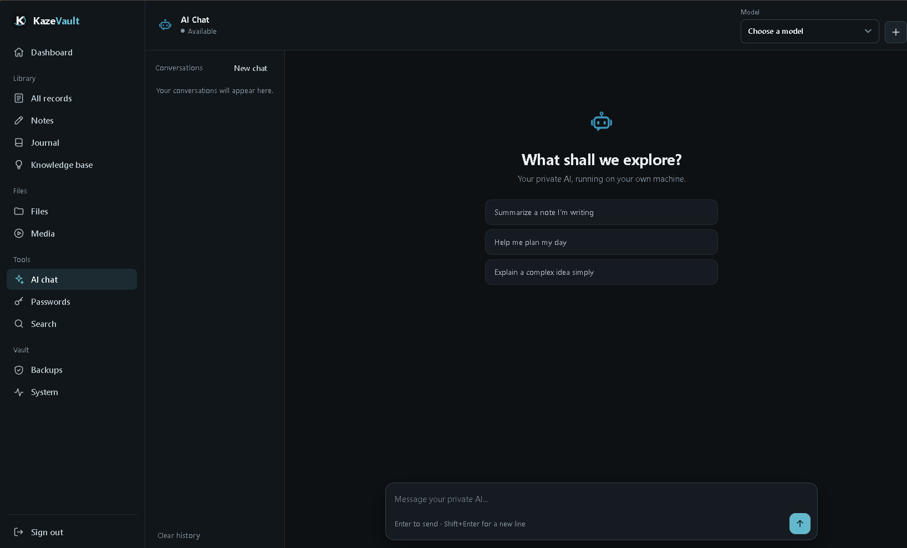

# KazeVault

KazeVault is a private, self-hosted Windows vault for records, notes, journals, knowledge entries, files, media, encrypted passwords, verified backups, and optional local AI chat. It uses FastAPI, SQLite, SQLAlchemy, and Argon2id. It is intended for personal or trusted-home use, not public internet exposure or enterprise security.

## Preview

### Dashboard

### File Explorer

### AI Chat

## Features

- Dashboard, records, notes, journals, knowledge base, categories, favorites, and metadata search.
- File Explorer with database-backed folders: All files, Videos, Images, Audio, Documents, Archives, Code, and Other.
- Automatic file grouping without moving or renaming stored files.
- Media previews, native audio/video playback, downloads, range requests, and fixed responsive thumbnails.
- Separate Password Manager using scrypt and AES-256-GCM.
- Verified ZIP backups and validated restore with automatic pre-restore backup.
- Read-only system diagnostics.
- Android/Chromium PWA support.
- Local, trusted-LAN, and private Tailscale remote modes.
- Optional local AI Hub using llama-server.exe and GGUF models.
- Argon2id passwords, signed sessions, CSRF protection, login throttling, host validation, and authenticated private routes.

## Installation

Requirements: Windows 10/11, Python 3.11+, a writable project directory, and a modern browser.

~~~powershell
cd F:\KazeVault
py -m venv .venv
.venv\Scripts\python.exe -m pip install -r requirements.txt
~~~

Do not delete data, backups, or model directories during updates.

## Local use

~~~powershell
cd F:\KazeVault
.\run.bat
~~~

Open http://127.0.0.1:8765 and create the administrator account on first launch. There is no default password. Stop with Ctrl+C or .\stop.bat. Local mode binds only to 127.0.0.1.

## LAN phone access

LAN mode uses unencrypted HTTP and is for trusted Wi-Fi only:

~~~powershell
cd F:\KazeVault
.\run-lan.bat
ipconfig
~~~

Use the connected Wi-Fi adapter IPv4 address, such as http://10.126.75.52:8765, from the phone. Both devices must be on the same Wi-Fi. If required, allow only TCP 8765 on the Private firewall profile:

~~~powershell
New-NetFirewallRule -DisplayName "KazeVault LAN" -Direction Inbound -Action Allow -Protocol TCP -LocalPort 8765 -Profile Private -RemoteAddress LocalSubnet
~~~

Never disable the firewall or configure router port forwarding.

## Private remote access with Tailscale

Install Tailscale on the Windows host and phone, sign into the same tailnet, and check:

~~~powershell
tailscale status
~~~

Start KazeVault and configure Serve:

~~~powershell
cd F:\KazeVault
.\run-remote.bat
tailscale serve --https=443 http://127.0.0.1:8765
tailscale serve status
~~~

Open the HTTPS hostname shown by tailscale serve status, for example https://your-machine.your-tailnet.ts.net/. Tailscale must be enabled on the phone. If Tailscale requests permission to enable Serve, approve its account page. Do not bypass TLS warnings or expose the URL publicly.

For another trusted proxy, configure trusted hosts explicitly:

~~~powershell
$env:KAZEVAULT_ALLOWED_HOSTS='your-machine.your-tailnet.ts.net'
$env:KAZEVAULT_PUBLIC_URL='https://your-machine.your-tailnet.ts.net'
~~~

## Android PWA

Open the HTTPS remote URL in Android Chrome, choose the browser menu, then Install app or Add to Home screen. The Windows host must remain online. Only non-sensitive static assets are cached; private pages, passwords, cookies, CSRF tokens, attachments, media, and API responses are not cached.

## Files, folders, and media

Data is stored here:

~~~text
data\                   SQLite database and application data
data\attachments\       Stored uploaded files
data\models\            Optional AI model directory
backups\                Verified ZIP backups
~~~

Each attachment has a database folder_id. Standard folders are created automatically: Videos, Images, Audio, Documents, Archives, Code, and Other. The All files view shows everything. New files are classified using MIME type and extension; their physical stored names remain unchanged. Archives are stored unchanged and never extracted.

The default upload limit is 512 MB:

~~~powershell
$env:KAZEVAULT_MAX_UPLOAD_MB='1024'
~~~

Browser codec support varies. Unsupported media remains downloadable. Thumbnails use fixed preview frames and may crop content.

## Password Manager

Passwords use a separate master password of at least 12 characters. Secrets use AES-256-GCM, with a key derived by scrypt and held in server memory only while unlocked. The default idle lock is 15 minutes:

~~~powershell
$env:KAZEVAULT_VAULT_IDLE_SECONDS='1800'
~~~

Forgetting the master password means encrypted secrets cannot be recovered. Secrets are not included in ordinary listings, search results, or backup manifests.

## Backups and restore

Use Backups to create, verify, download, delete, and restore archives. Archives contain a consistent SQLite copy, manifest.json, and attachment paths, sizes, and SHA-256 hashes. Restore requires authentication and typing RESTORE. KazeVault creates a verified pre-restore backup, stages and validates data, and attempts rollback on failure. Restart after successful restore.

The only verified backup cannot be deleted. Copy verified ZIPs to another physical drive or encrypted storage. Same-disk backups do not protect against disk failure, theft, or ransomware. Use BitLocker or Windows Device Encryption.

Dedicated model binaries in data\models are excluded from ordinary backups. AI metadata and conversations in SQLite are included. GGUF files uploaded as ordinary attachments follow normal attachment backup behavior.

## Private AI Hub

AI Chat is optional and never sends prompts to an external provider. Configure an existing local llama-server.exe before starting:

~~~powershell
$env:KAZEVAULT_LLAMA_SERVER='F:\llama\llama-server.exe'
$env:KAZEVAULT_AI_MODEL_DIR='F:\KazeVault\data\models'
$env:KAZEVAULT_LLAMA_ENDPOINT='http://127.0.0.1:8081'
$env:KAZEVAULT_AI_CONTEXT='2048'
$env:KAZEVAULT_AI_MAX_TOKENS='512'
& 'F:\llama\llama-server.exe' --version
~~~

The included remote launcher already uses F:\llama\llama-server.exe for this installation. Put compatible .gguf files in F:\KazeVault\data\models or upload them through Files. Only valid GGUF files in approved locations are listed; there are no automatic downloads or arbitrary system scans.

Open AI Chat, select a model, choose Load, wait for backend health confirmation, and then chat. Only one model is active at a time. Performance depends on model size, context, CPU, memory, and the llama.cpp build; GPU acceleration is not assumed. The inference endpoint remains loopback-only.

Conversations are stored in SQLite. Removing one conversation deletes only it; Clear history removes all AI conversations. Vault records, files, password secrets, session tokens, and private keys are never automatically inserted into prompts.

## Security

Administrator passwords use Argon2id. Sessions are signed and expire after eight hours. Set KAZEVAULT_HTTPS=1 for HTTPS secure cookies. State-changing forms and AI operations require CSRF tokens. Failed logins are temporarily throttled. Private routes require authentication. Host headers are validated. Upload filenames reject traversal and control characters, stored names are random, and downloads use nosniff and restrictive content-security headers.

These controls do not protect data from someone who controls the Windows account, running process, disk, or backup files.

## Configuration

| Variable | Purpose | Default |
|---|---|---|
| KAZEVAULT_DATA | Database/data root | data |
| KAZEVAULT_MODE | local, lan, or remote | local |
| KAZEVAULT_HTTPS | Secure-cookie mode | 0 |
| KAZEVAULT_ALLOWED_HOSTS | Trusted hostnames | empty plus testserver |
| KAZEVAULT_PUBLIC_URL | Safe dashboard URL | empty |
| KAZEVAULT_MAX_UPLOAD_MB | Upload limit | 512 |
| KAZEVAULT_VAULT_IDLE_SECONDS | Password idle timeout | 900 |
| KAZEVAULT_AI_MODEL_DIR | Approved GGUF directory | data\models |
| KAZEVAULT_LLAMA_SERVER | Inference executable | unset |
| KAZEVAULT_LLAMA_ENDPOINT | Loopback inference URL | http://127.0.0.1:8081 |
| KAZEVAULT_AI_CONTEXT | Context setting | 2048 |
| KAZEVAULT_AI_MAX_TOKENS | Generation setting | 512 |

Never put passwords or private keys in source code or frontend JavaScript.

## Troubleshooting

- Setup 422: open the root URL; setup requires form data and redirects if an administrator exists.
- LAN failure: check same Wi-Fi, IPv4 address, run-lan.bat, and Private firewall rules. Guest networks may isolate devices.
- Remote timeout: check tailscale status, Serve status, run-remote.bat, and Tailscale on the phone.
- TLS error: use the exact Serve HTTPS hostname and check Tailscale certificate status.
- No AI models: confirm .gguf extension, valid GGUF header, and approved directory.
- AI load failure: verify llama-server.exe with --version, port 8081, backend arguments, and available memory.
- Media failure: try Download file or a local player; browser codecs vary.
- Backup failure: review the verification message, check free space, never delete data, and restart after restore.
- Port conflict:

~~~powershell
netstat -ano | findstr :8765
~~~

Stop only a process you recognize as KazeVault, or change the port consistently in launcher, proxy, firewall rule, and URL.

## Tests and safe updates

Run:

~~~powershell
.venv\Scripts\python.exe -m pytest -q
~~~

Tests cover authentication, CSRF, throttling, uploads, backups, restore validation, password encryption, media ranges, folders, PWA routes, host validation, AI validation, missing backend behavior, and conversation deletion. Tests use temporary databases and do not download large models. No formatter, linter, or type-check command is configured.

To update safely: stop KazeVault, create or verify a backup, replace application files without deleting data/backups/models, install changed requirements, run tests, restart, and hard-refresh browsers. Never expose KazeVault directly to the public internet or reset the database to fix an error.

